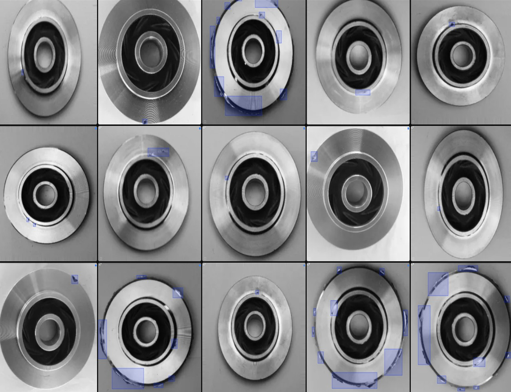

# Real-Time Computer Vision Inspection System for Casting Defect Detection on Machinery Hubs

An automated, real-time surface defect detection pipeline built with **YOLOv8n** and **OpenCV** to inspect cast metal machinery hubs (JCB hub components) for structural flaws such as cracks, surface defects, and porosity.

---

## Overview & Problem Statement
Traditional quality control in metal casting relies heavily on manual visual inspection, which is slow, labor-intensive, inconsistent across operators, and difficult to scale with production speed. This project replaces manual checks with a lightweight, edge-deployable computer vision pipeline capable of running locally on standard CPU hardware without specialized enterprise GPUs.

---

## Key Features
* **Custom-Trained Defect Detector:** Fine-tuned **YOLOv8n** (`best.pt`) on ~1,600 annotated casting defect images (`imgsz=640`, 30 epochs) achieving **89% mAP@50** (`0.0125` final training loss).
* **Real-Time Local Inference (`scanner.py`):** Processes live camera/image streams at **~47–62 ms per frame** on local CPU hardware.
* **Automated Pass / Reject Overlay & Logging:**
  * Displays **`GOOD`** in green when no defects are detected.
  * Draws real-time bounding boxes with confidence scores over detected defects and automatically logs defective frames into `saved_defects/` at 2-second intervals for quality traceability.

---

## Dataset & Inference Results

### 1. Annotated Casting Defect Dataset (~1,600 Images)
Sample training frames from the custom-annotated casting dataset showing ground-truth bounding boxes around surface pits, edge chipping, and structural irregularities[cite: 16, 17]:



### 2. Real-Time Detection Output (`scanner.py`)
Live YOLOv8n + OpenCV inference localizing a surface casting defect with confidence score overlay[cite: 16, 18]:


---

## System Architecture & Workflow

```text
[Industrial Camera + Controlled Lighting]
                  │
                  ▼
     [OpenCV Frame Acquisition]
                  │
                  ▼
  [YOLOv8n Fine-Tuned Model (best.pt)]
          ├── No Defect ──► Overlay "GOOD" (Pass)
          └── Defect    ──► Bounding Box + Confidence Score + Auto-Log (2s interval)
